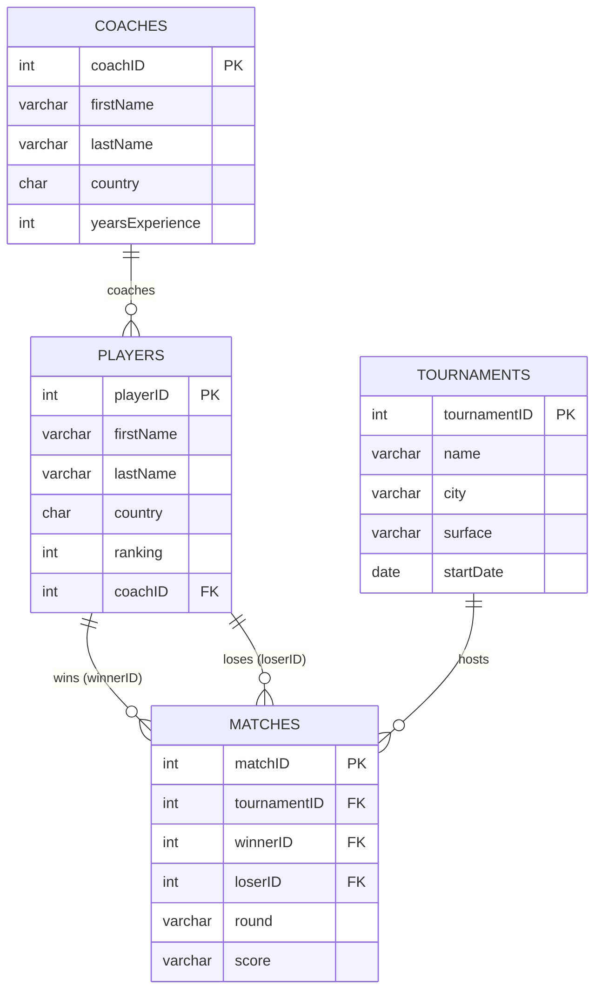

# Tennis Tournament Database

A relational database in MySQL for tracking tennis players, their coaches, tournaments, and match results, similar to what a tennis federation uses to keep records. Built as the midterm project for ECE 471 (Design of Database Systems) at Christian Brothers University.

## Schema



`Matches` references `Players` twice, once for the winner and once for the loser. Most of the queries below are built around that design.

## Queries

| # | Concept | What it answers |
|---|---------|-----------------|
| 1 | INNER JOIN | Full match results with tournament and player names |
| 2 | INTERSECT / EXCEPT / UNION | Players who both won and lost, and players who never lost |
| 3 | GROUP BY | Matches played per surface (clay vs. hard) |
| 4 | HAVING | Players with 2 or more wins |
| 5 | Subquery in WHERE | Players coached by the most experienced coach |
| 6 | Subquery in FROM | Tournaments with an above-average number of matches |
| 7 | Correlated subquery | Players ranked better than their country's average |
| 8 | Derived tables + LEFT JOIN | Win/loss record for every player |

### Example: win/loss record (query 8)

```
+-----------+----------+------+--------+
| firstName | lastName | wins | losses |
+-----------+----------+------+--------+
| Pablo     | Ruiz     |    3 |      0 |
| Mateo     | Vera     |    2 |      1 |
| Lucas     | Bennett  |    2 |      1 |
| Ryan      | Cole     |    1 |      1 |
| Javier    | Molina   |    1 |      1 |
| Tomas     | Ferreyra |    1 |      3 |
| Andres    | Cedeno   |    0 |      1 |
| Diego     | Zambrano |    0 |      2 |
+-----------+----------+------+--------+
```

## How to run

Requires MySQL 8.0.31+ (for `INTERSECT` and `EXCEPT`).

```bash
mysql -u root -p < schema.sql
mysql -u root -p < queries.sql
```

Or open both files in MySQL Workbench and run `schema.sql` first.

## Files

- `schema.sql`: creates the database and tables, and inserts the sample data
- `queries.sql`: the 8 queries above

## Demo

[Video walkthrough](https://youtu.be/xivOQkvLlzY)
